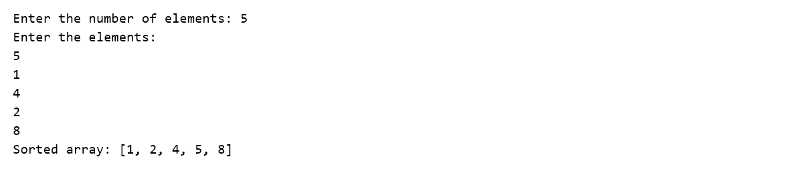

# Bubble Sort

## Conclusion

The program sorts the entered integers in ascending order by repeatedly swapping adjacent out-of-order elements. It performs the same nested-loop comparisons even when the input is already sorted.

## Complexity

- **Time:** Best, average, and worst case: `O(n^2)`.
- **Auxiliary space:** `O(1)` (the input array is not counted).

## Sample Output

