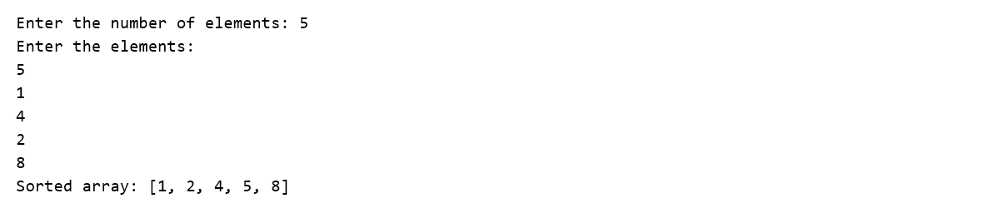

# Insertion Sort

## Conclusion

The program builds a sorted prefix by inserting each next value into its correct position. It is efficient for already or nearly sorted input, but may shift every earlier element for each insertion.

## Complexity

- **Time:** Best case: `O(n)`; average and worst case: `O(n^2)`.
- **Auxiliary space:** `O(1)` (the input array is not counted).

## Sample Output

