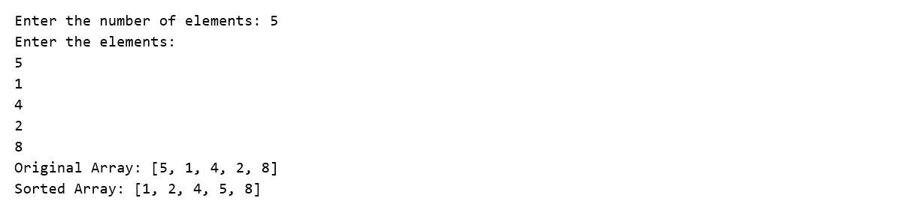

# Merge Sort

## Conclusion

The program recursively divides the input into halves, sorts each half, and merges the sorted halves to produce the result in ascending order.

## Complexity

- **Time:** Best, average, and worst case: `O(n log n)`.
- **Auxiliary space:** `O(n)` for the temporary sublists used during recursion.

## Sample Output

