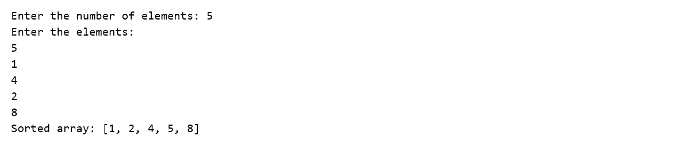

# Selection Sort

## Conclusion

The program repeatedly selects the smallest value from the unsorted portion and places it at the next position. Its comparison count remains quadratic regardless of the initial order.

## Complexity

- **Time:** Best, average, and worst case: `O(n^2)`.
- **Auxiliary space:** `O(1)` (the input array is not counted).

## Sample Output

