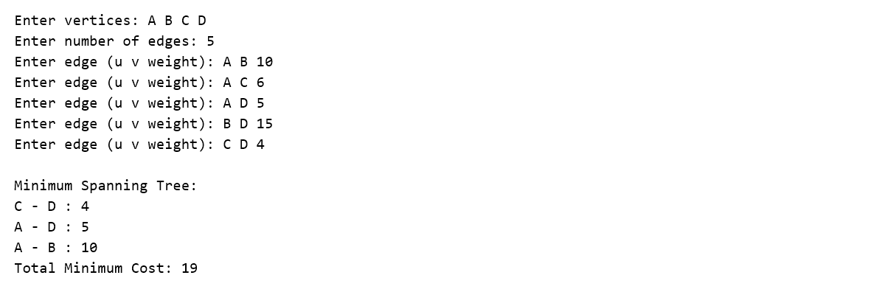

# Kruskal's Algorithm

## Conclusion

The program sorts the graph edges by weight and uses disjoint sets to add edges that do not form a cycle. It prints a minimum spanning tree and its total cost, or reports that the graph is disconnected.

## Complexity

- **Time:** `O(E log E)` for sorting the `E` edges; disjoint-set operations add near-linear overhead.
- **Auxiliary space:** `O(V + E)` including the disjoint-set structures, selected tree, and Python's edge-sorting workspace.

## Sample Output

