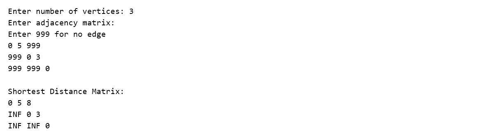

# Floyd-Warshall Algorithm

## Conclusion

The program computes the shortest-path distance between every pair of vertices by allowing each vertex to serve as an intermediate point. `999` in the input is treated as no direct edge and displayed as `INF` when no path exists.

## Complexity

- **Time:** `O(V^3)`.
- **Auxiliary space:** `O(V^2)` for the copied distance matrix.

## Sample Output

