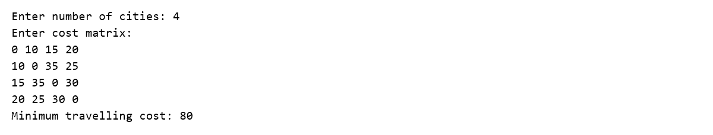

# Travelling Salesperson Problem

## Conclusion

The program uses a bitmask dynamic-programming table to find the minimum cost of a tour that starts at city 0, visits every city once, and returns to city 0.

## Complexity

- **Time:** `O(n^2 * 2^n)`.
- **Auxiliary space:** `O(n * 2^n)` for the dynamic-programming table.

## Sample Output

