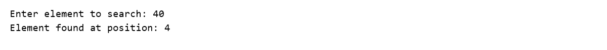

# Binary Search

## Conclusion

The program searches the fixed, sorted array by repeatedly discarding half of the remaining range. It reports the matching position using one-based indexing, or reports that the element is absent.

## Complexity

- **Time:** Best case: `O(1)`; average and worst case: `O(log n)`.
- **Auxiliary space:** `O(1)`.

## Sample Output

