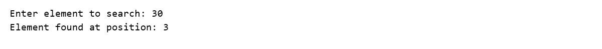

# Linear Search

## Conclusion

The program checks each element of the fixed array in order and reports the first matching position using one-based indexing. If no value matches, it reports that the element is absent.

## Complexity

- **Time:** Best case: `O(1)`; average and worst case: `O(n)`.
- **Auxiliary space:** `O(1)`.

## Sample Output

