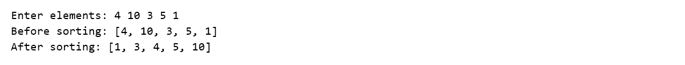

# Heap Sort

## Conclusion

The program builds a max heap, repeatedly moves its largest value to the end of the array, and produces the values in ascending order.

## Complexity

- **Time:** Best, average, and worst case: `O(n log n)`.
- **Auxiliary space:** `O(log n)` for the recursive `heapify` call stack; sorting is otherwise in place.

## Sample Output

