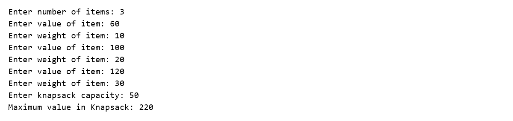

# 0/1 Knapsack

## Conclusion

The program uses dynamic programming to choose a subset of items whose total weight does not exceed the capacity while maximizing total value. Each item can be selected at most once.

## Complexity

- **Time:** `O(nW)`, where `n` is the number of items and `W` is the capacity.
- **Auxiliary space:** `O(nW)` for the dynamic-programming table.

## Sample Output

