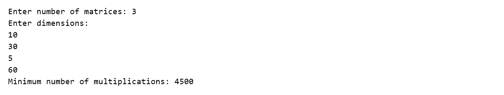

# Matrix Chain Multiplication

## Conclusion

The program uses dynamic programming to find the minimum number of scalar multiplications needed to multiply a chain of matrices. It chooses the parenthesization with the lowest multiplication cost.

## Complexity

- **Time:** `O(n^3)`, where `n` is the number of matrices.
- **Auxiliary space:** `O(n^2)` for the cost table.

## Sample Output

