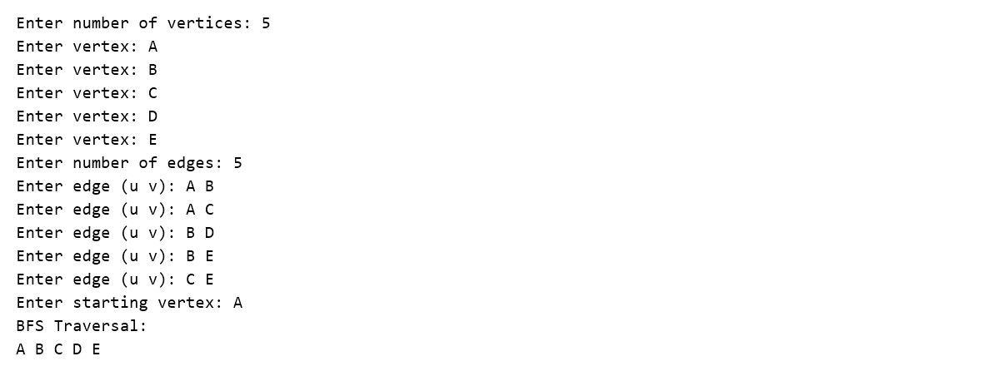

# Breadth-First Search (BFS)

## Conclusion

The program traverses the connected portion of the undirected graph from the chosen start vertex, visiting vertices in queue order and printing each vertex once.

## Complexity

- **Time:** `O(V + E)` using the adjacency-list representation.
- **Auxiliary space:** `O(V)` for the visited set and queue.

## Sample Output

