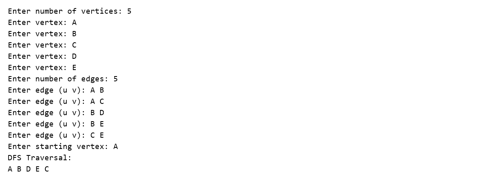

# Depth-First Search (DFS)

## Conclusion

The program recursively traverses the connected portion of the undirected graph from the chosen start vertex, printing each vertex once before exploring its neighbours.

## Complexity

- **Time:** `O(V + E)` using the adjacency-list representation.
- **Auxiliary space:** `O(V)` for the visited set and recursion stack.

## Sample Output

