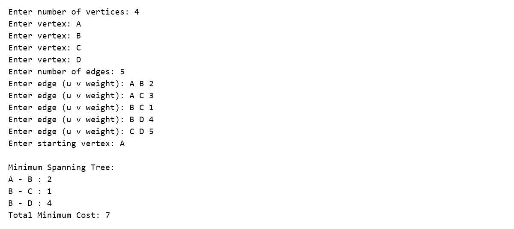

# Prim's Algorithm

## Conclusion

Starting from the selected vertex, the program repeatedly adds the lowest-weight edge that connects the current tree to an unselected vertex. It prints the minimum spanning tree and total cost, or reports that the graph is disconnected.

## Complexity

- **Time:** `O(VE)` for this implementation, which rescans edges incident to selected vertices on each iteration.
- **Auxiliary space:** `O(V)` for the selected vertices and spanning tree, excluding the input adjacency list.

## Sample Output

